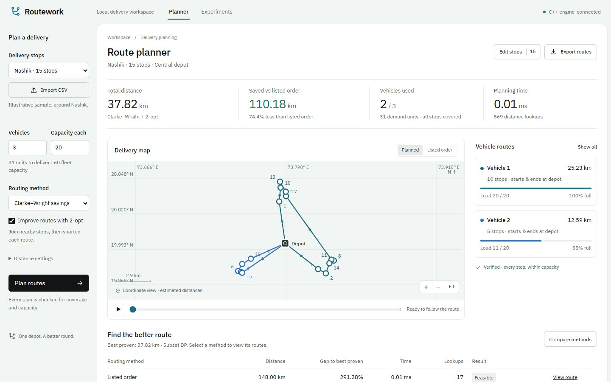

# DSA · Vehicle Routing Planner

A C++17 Capacitated Vehicle Routing Problem mini project with an interactive local
web interface. The routing engine uses only the C++ standard library; the optional
web server uses Node.js built-ins with no npm dependencies.



## Get started

```sh
git clone https://github.com/rehan-03/DSA.git
cd DSA/vrp-planner
make
make test
```

Requires a C++17 compiler and GNU Make. To launch the web interface, install
Node.js 22+ and run:

```sh
make web
```

Open **http://127.0.0.1:3000**. On Windows, `vrp-planner/start-web.cmd` builds the
executable when Make is available and opens the local planner. A C++ compiler is
not bundled with this repository.

## What is included

- CSV validation, Haversine distance matrices, and independent solution verification.
- Listed-order baseline, Nearest Neighbour, Clarke–Wright, Sweep, 2-opt and local search.
- Backtracking, FIFO/LIFO/least-cost Branch and Bound, Held–Karp and exact subset DP.
- Custom min-heap, heap sort, Prim and Kruskal lower bounds, counters and timers.
- A browser planner with editable stops, CSV import/export, route playback, vehicle
  capacity views, algorithm comparisons and interactive experiment results.
- Ten-run E1–E8 measurements: **2,060 records**, summaries, graphs and route drawings.
- **6,473 C++ checks**, CLI regressions and eight real-engine web API tests.

```sh
./vrp solve --input data/nashik_tiffin_15.csv --vehicles 3 --capacity 20 --algo cw+2opt
./vrp compare --input data/nashik_tiffin_15.csv --vehicles 3 --capacity 20
make web-test
```

The Nashik datasets are explicitly **synthetic illustrative samples**. Maps show
coordinates and estimated distances, not street navigation or live traffic.

See the [full README](vrp-planner/README.md), [project report](vrp-planner/REPORT.md),
[demo guide](vrp-planner/DEMO.md), and [experiment results](vrp-planner/results/results.csv).
